# 课有度动作数据集

面向中文健身应用与开发者的结构化动作数据集：1,296 个动作、3,931 张 AI 生成的 WebP 动作图，每个动作都有中文名称、中英文分步说明、身体部位、器械和目标肌群。

> **重要提示：** 这些内容没有经过运动医学人员或专业教练逐项审核。图片和文字都由 AI 生成或整理，只做过 AI 目视筛选，仍可能有错误。本项目不构成训练、医疗或安全建议，用于产品前请自行审核。已知问题见 [docs/KNOWN_ISSUES.md](docs/KNOWN_ISSUES.md)。

**在线浏览：** <https://zhouxishun1993-code.github.io/keyoudu-exercise-dataset/>　·　[English summary](#english)

## 数据概览

| 项目 | 数量 |
| --- | --- |
| 动作 | 1,296 个动作 |
| 图片 | 3,931 张（每个动作一张缩略图，加 1 至 4 张动作阶段图） |
| 只有开始与结束两个阶段的动作 | 1,268 |
| 含中间阶段的动作 | 26 |
| 静态保持动作 | 2 |
| 按时长计量的动作 | 63（其余按次数） |
| 中文与英文说明 | 全部动作都有，步骤一一对应 |

按身体部位：上臂 291、臀腿 223、背部 197、胸部 161、核心 160、肩部 142、小腿 58、前臂 34、有氧 29、颈部 1。

按器械（前十）：自重 304、哑铃 290、绳索 157、杠铃 156、固定器械 93、弹力带 61、史密斯机 48、壶铃 41、负重 35、瑞士球 27。完整取值见[字段说明](docs/DATA_DICTIONARY.md)。

## 图片示例

以下图片直接引用仓库内的 AI 生成图，分别是动作的开始与结束姿势。

<table>
  <thead>
    <tr>
      <th>动作</th>
      <th>开始</th>
      <th>结束</th>
    </tr>
  </thead>
  <tbody>
    <tr>
      <td>俯卧撑 <code>ex-0662</code></td>
      <td>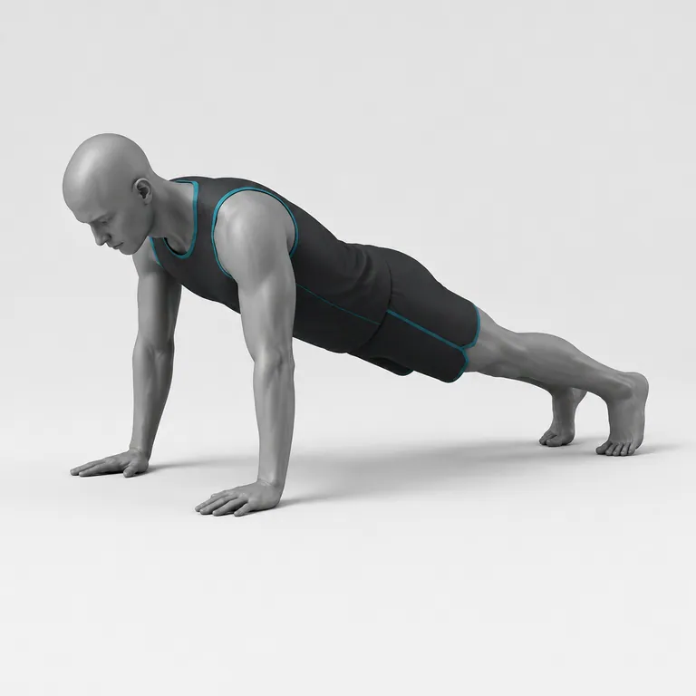</td>
      <td>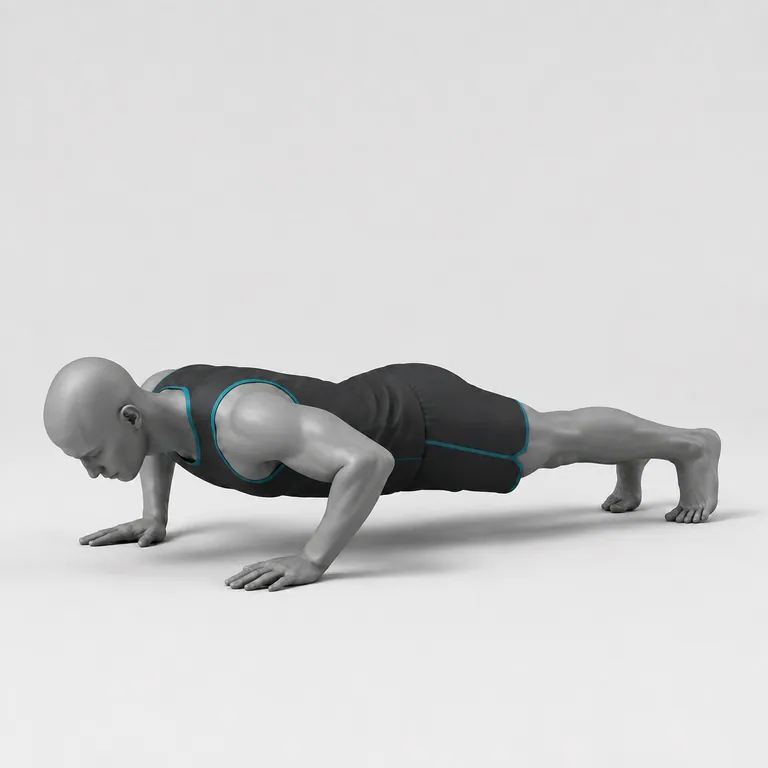</td>
    </tr>
    <tr>
      <td>徒手深蹲（胸前合手） <code>ex-3119</code></td>
      <td>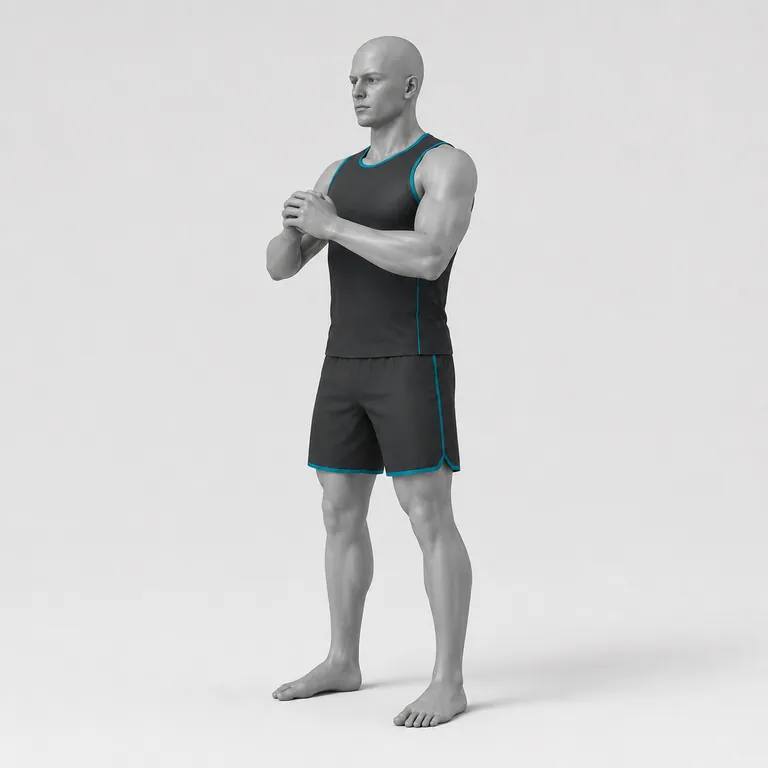</td>
      <td>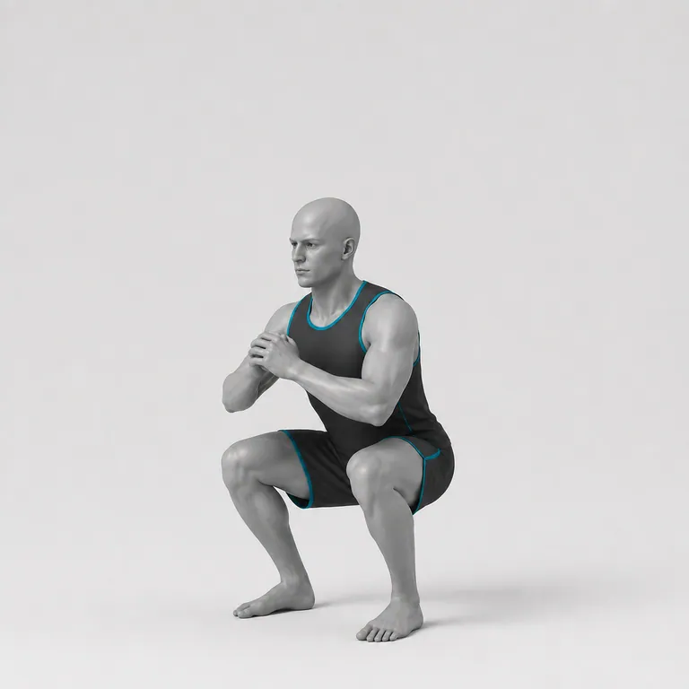</td>
    </tr>
    <tr>
      <td>哑铃双臂弯举 <code>ex-0294</code></td>
      <td>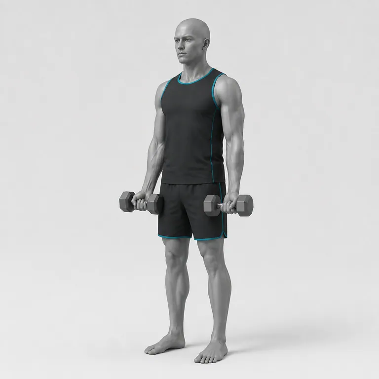</td>
      <td>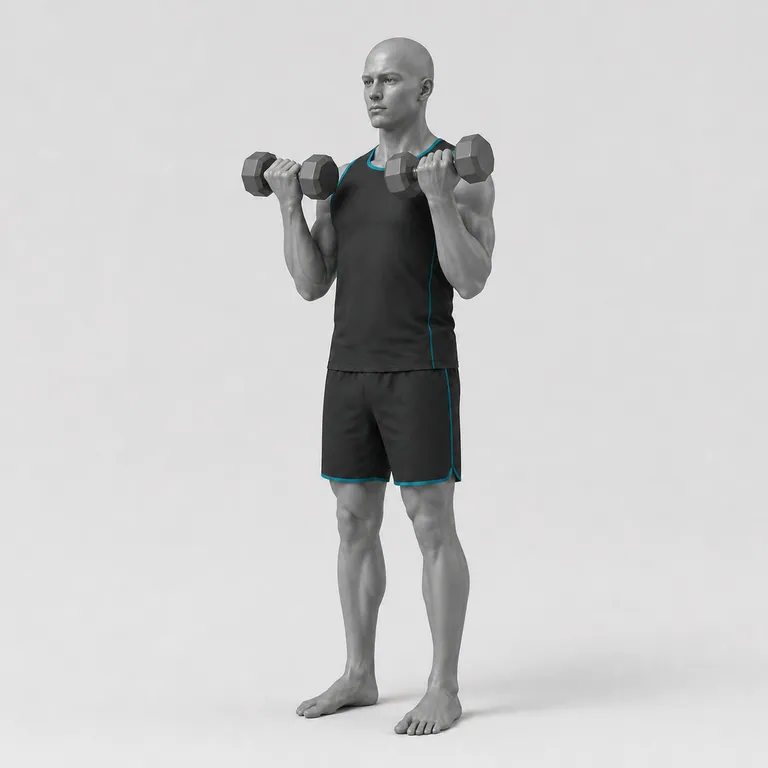</td>
    </tr>
    <tr>
      <td>绳索中位夹胸 <code>ex-0188</code></td>
      <td>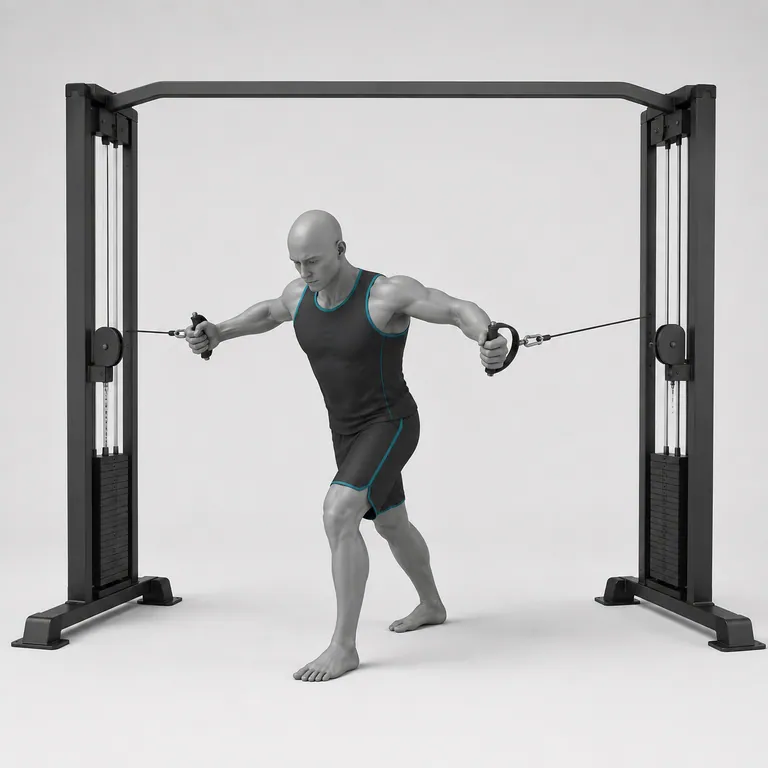</td>
      <td>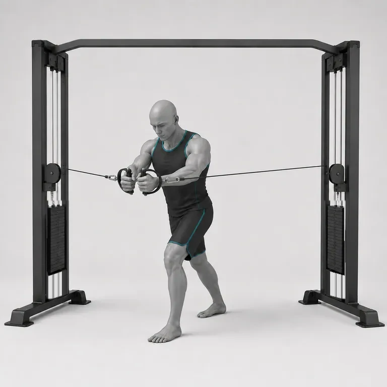</td>
    </tr>
    <tr>
      <td>绳索高位下拉 <code>ex-0198</code></td>
      <td>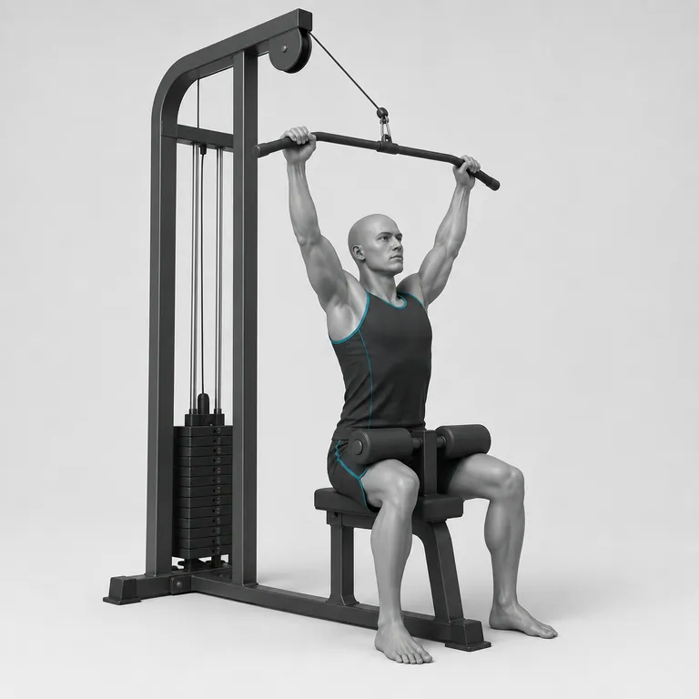</td>
      <td>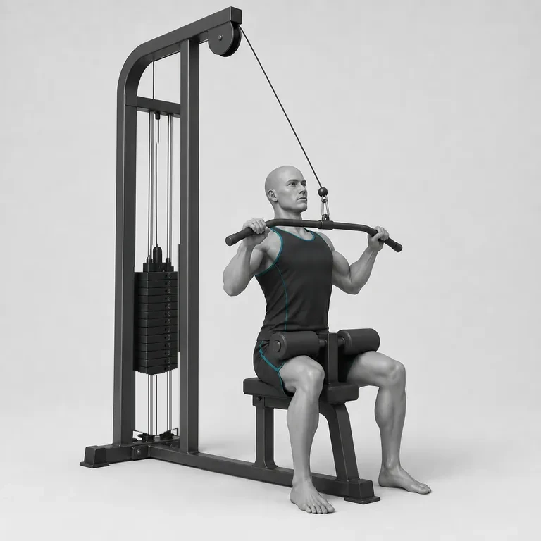</td>
    </tr>
    <tr>
      <td>器械坐姿划船 <code>ex-1350</code></td>
      <td>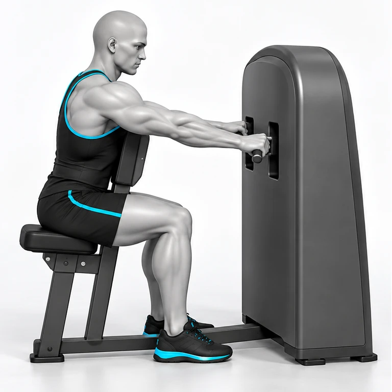</td>
      <td>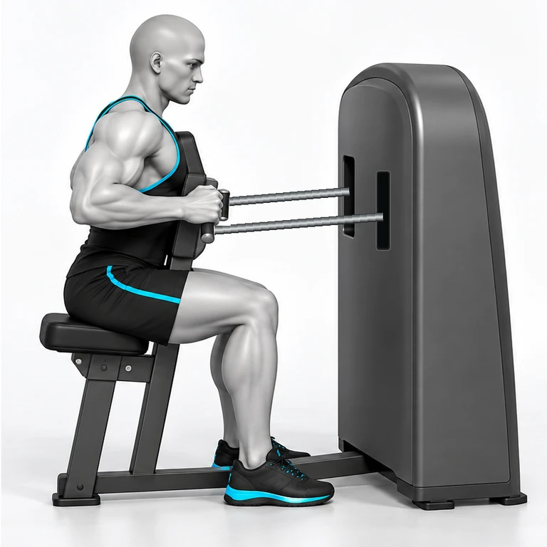</td>
    </tr>
    <tr>
      <td>45度腿举 <code>ex-0739</code></td>
      <td>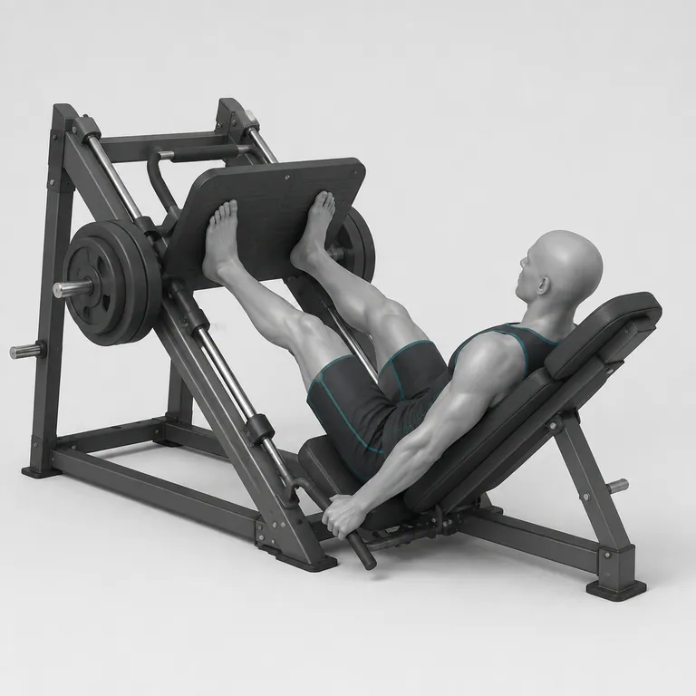</td>
      <td>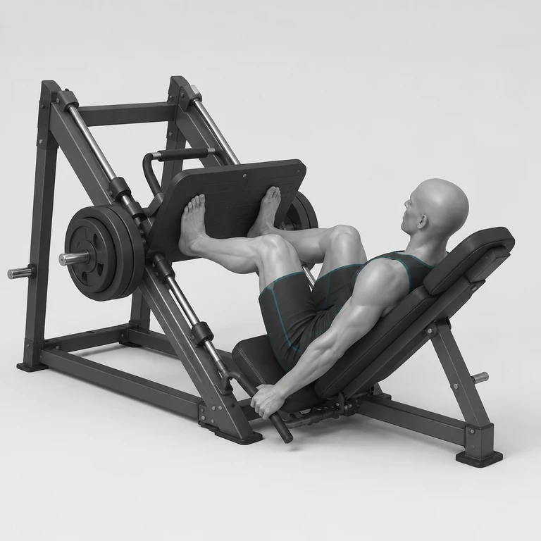</td>
    </tr>
    <tr>
      <td>哈克深蹲 <code>ex-0743</code></td>
      <td>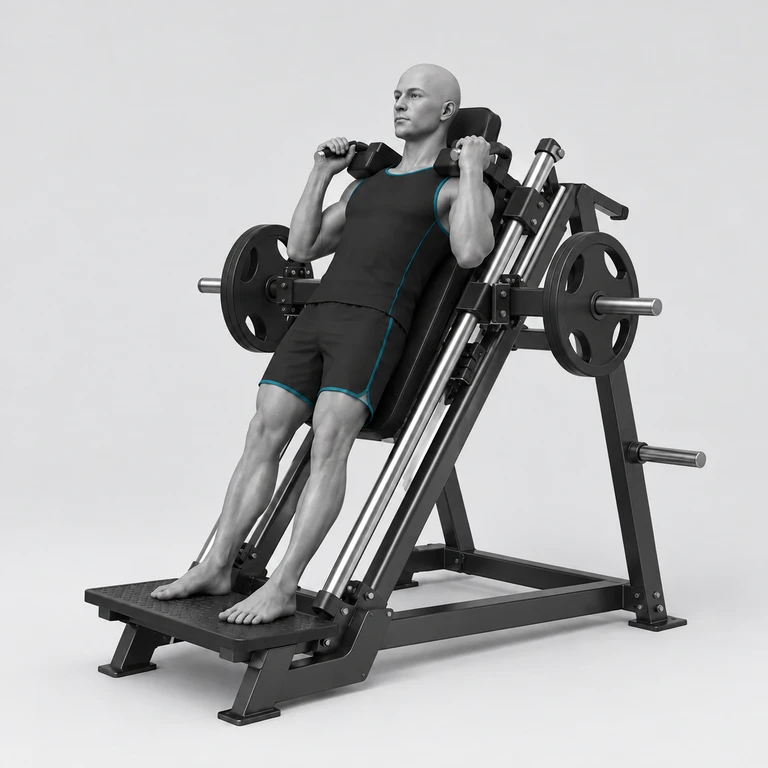</td>
      <td>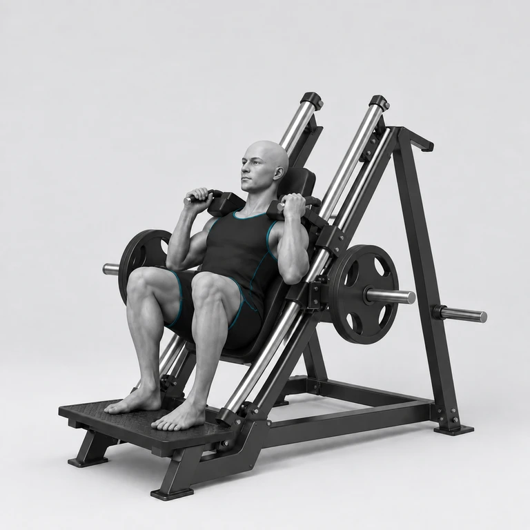</td>
    </tr>
  </tbody>
</table>

## 快速使用

**直接浏览：** 打开[在线浏览页](https://zhouxishun1993-code.github.io/keyoudu-exercise-dataset/)，或者克隆、下载仓库后双击根目录的 `index.html` 离线使用。两者都可以搜索，并按身体部位、器械和目标肌群筛选，不需要安装依赖或启动服务器。

**文件入口：**

| 路径 | 说明 |
| --- | --- |
| `data/exercises.json` | 规范数据文件（UTF-8，缩进格式） |
| `data/exercises.schema.json` | JSON Schema（2020-12） |
| `data/exercises.js` | 供 `file://` 离线浏览页使用的压缩快照，内容与 JSON 相同 |
| `images/` | 统一命名的 WebP 图片，如 `ex-0001-thumb.webp`、`ex-0001-start.webp`、`ex-0001-end.webp` |
| `SHA256SUMS.txt` | 仓库内每个文件的 SHA-256 校验和 |

**Node.js 示例：**

~~~js
import { readFile } from "node:fs/promises";

const dataset = JSON.parse(
  await readFile(new URL("./data/exercises.json", import.meta.url), "utf8")
);

const dumbbellBiceps = dataset.exercises.filter(
  (exercise) => exercise.equipment === "哑铃" && exercise.target === "biceps"
);

for (const exercise of dumbbellBiceps.slice(0, 3)) {
  console.log(exercise.id, exercise.name_zh, exercise.media.frames.map((frame) => frame.path));
}
~~~

**Python 示例：**

~~~python
import json
from pathlib import Path

dataset = json.loads(Path("data/exercises.json").read_text(encoding="utf-8"))
holds = [e for e in dataset["exercises"] if e["measurement"] == "duration"]
print(len(holds), holds[0]["name_zh"], holds[0]["instructions_zh"])
~~~

## 字段

每条动作包含 `id`、`name_zh`、`aliases`、`body_part`、`equipment`、`target`、`target_zh`、`measurement`、`instructions_zh`、`instructions_en`、`source`、`media`、`review`。

- `media.frames` 是按展示顺序排列的动作图，每帧带 `phase`、`path`、`sha256` 和 `dimensions`；`media.sequence` 是播放顺序，可以包含返回阶段，例如 `start-middle-end-middle-start`。
- `media.start`、`media.end` 和 `media.thumbnail` 是兼容字段。静态保持动作的 `frames` 只有 `hold`，它的 `start` 与 `end` 指向内容相同的图片。
- 所有 `review.professional_review` 都是 `not_performed`。

每个字段的含义、取值范围和统计见 [docs/DATA_DICTIONARY.md](docs/DATA_DICTIONARY.md)。

## 验证

仓库不依赖第三方 npm 包。安装 Node.js 20 或更高版本后运行：

~~~sh
npm test
~~~

校验内容：数据是否符合 JSON Schema、编号和名称是否唯一、中英文步骤数是否一致、说明里是否混入图片审核备注、图片引用与 WebP 实际尺寸、每张图的哈希、离线快照与规范 JSON 是否一致、`SHA256SUMS.txt`，以及本文档里的数量是否与数据相符。每次推送和拉取请求都会在 GitHub Actions 上自动运行。

## 版本

数据集版本写在 `package.json` 和 `data/exercises.json` 的 `dataset_version`，数据结构版本写在 `schema_version`。在 1.0 之前，次版本号变化可能调整字段或取值；每次变化都记在 [CHANGELOG.md](CHANGELOG.md)。动作 `id` 沿用上游编号，不会重新分配。

## 来源与许可证

动作结构和文本基于 [hasaneyldrm/exercises-dataset](https://github.com/hasaneyldrm/exercises-dataset) 固定提交 `7455efae41b330c265e7cd4b78dfa848e7ce5ebd` 的 MIT 许可内容，并经过中文整理和改写。该上游项目把自身的 `images/` 与 `videos/` 排除在 MIT 许可之外；本仓库没有复制上游的图片、GIF 或视频。

图片使用 OpenAI 的图像生成模型 GPT Image 2 生成，以 WebP 格式发布。

本仓库的代码与数据改编采用 MIT License。AI 生成图片由“课有度 Keyoudu”以 CC BY 4.0 提供；使用图片时请保留署名、许可证链接并标明修改。详见 [LICENSE](LICENSE)、[媒体许可证](LICENSE-MEDIA.md)、[NOTICE](NOTICE.md) 与 [第三方声明](THIRD_PARTY_NOTICES.md)。

引用本数据集时可以使用仓库根目录的 [CITATION.cff](CITATION.cff)。

## 贡献

欢迎提交数据纠错、动作定义、无障碍改进和可核实的图像问题，请先阅读 [CONTRIBUTING.md](CONTRIBUTING.md) 和[行为准则](CODE_OF_CONDUCT.md)。新图片必须有清晰来源和可再分发权利；不要提交来源不明的健身 GIF、截图或商业素材。

## English

Keyoudu Exercise Dataset is a Chinese-first fitness exercise dataset for developers: 1,296 exercises and 3,931 AI-generated WebP images. Every record has a Chinese name, step-by-step instructions in Chinese and English, a body region, equipment, a primary target, and an ordered list of movement frames.

- **Use it:** browse [online](https://zhouxishun1993-code.github.io/keyoudu-exercise-dataset/), open `index.html` for an offline browser, or read `data/exercises.json` (schema in `data/exercises.schema.json`). Field reference: [docs/DATA_DICTIONARY.md](docs/DATA_DICTIONARY.md) (the `body_part`, `equipment` and `target_zh` values are Chinese; `target` keeps the upstream English key).
- **Verify it:** `npm test` (Node.js 20+, no dependencies).
- **License:** data and code are MIT; generated images are CC BY 4.0 with attribution to “课有度 Keyoudu”. Exercise structure and text derive from [hasaneyldrm/exercises-dataset](https://github.com/hasaneyldrm/exercises-dataset) at commit `7455efae`, whose own media is not included here. The images were generated with OpenAI's GPT Image 2 model.
- **Caveat:** neither the text nor the images have been reviewed by a medical professional or certified trainer, and both are AI-generated or AI-edited. Do not treat this repository as medical, safety, or training advice. See [docs/KNOWN_ISSUES.md](docs/KNOWN_ISSUES.md).
